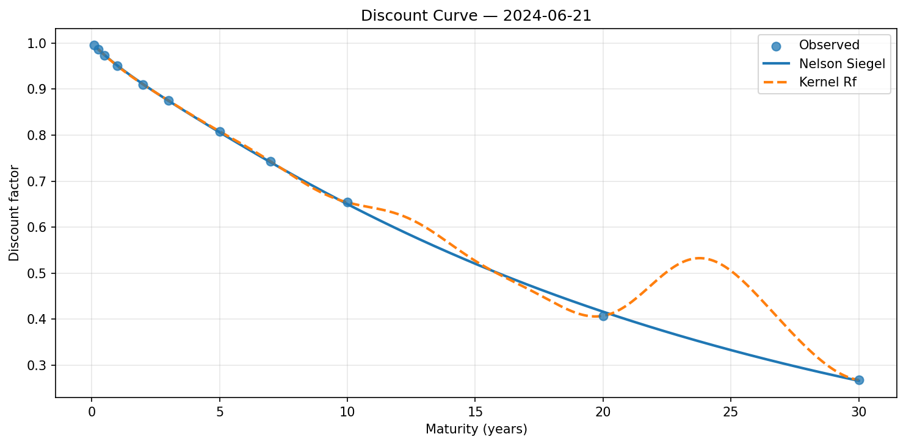
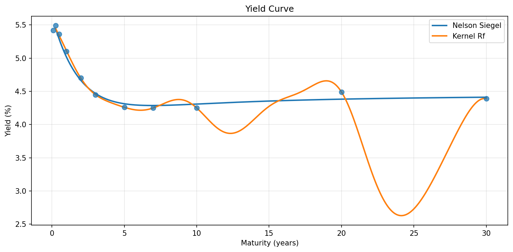
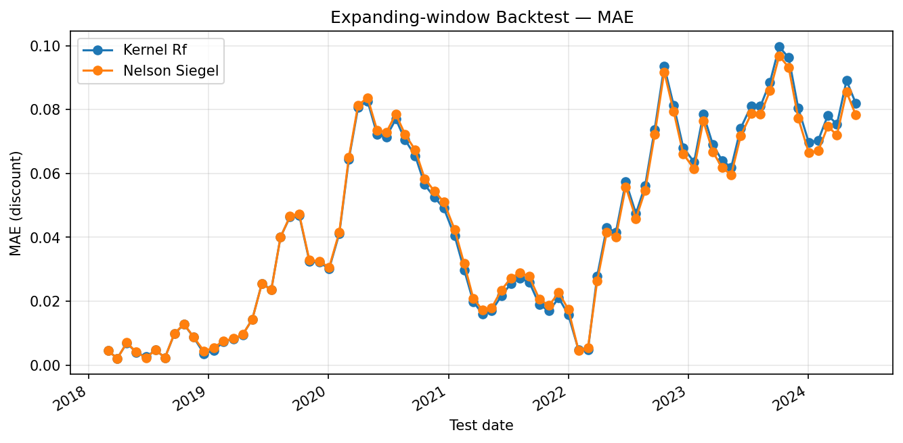

# Robust Machine Learning for Discount Curve Estimation

Leakage-aware and robustness-focused estimation of the risk-free discount (zero-coupon) curve from Treasury securities, using classical parametric models and modern kernel / random-feature methods.

**Author:** Azizallah Farhadi · `farhadmy1974@gmail.com`  
**Status:** Research prototype (Nov 2026)  
**Target audience:** Quantitative finance research groups emphasising *applied machine learning* (e.g. Swissquote Chair in Quantitative Finance, EPFL)

---

## 1. Motivation

Accurate recovery of the discount function \(d(\tau)\) (or the corresponding yield curve) is a core problem in:

- Fixed-income pricing and relative-value analysis
- Risk management (duration, convexity, key-rate exposures)
- Monetary-policy and macro-finance research
- Downstream tasks such as stochastic control and optimal hedging

Classical parametric families (Nelson-Siegel, Svensson) are parsimonious and stable but can be rigid. Purely nonparametric smoothers risk overfitting, especially in the presence of quote errors and outliers. Recent work (including research associated with the Swissquote Chair) shows that carefully designed machine-learning estimators operating in economically motivated function spaces, combined with robust losses, can improve both statistical fit and economic performance.

This repository implements a transparent, reproducible comparison of:

- Nelson-Siegel (parametric baseline)
- Kernel ridge regression via random Fourier features (flexible ML estimator)

with explicit attention to **robustness** (outliers) and clean evaluation protocols.

---

## 2. Data

| Source                         | Content                                                                 | Coverage (this repo)      |
| ------------------------------ | ----------------------------------------------------------------------- | ------------------------- |
| Synthetic Treasury panel       | Multi-day cross-sections around a slowly varying Nelson-Siegel curve, with realistic noise and controlled outliers | 80 business days × ~48 bonds |
| User-supplied CSV (optional)   | Any panel with columns `date, maturity, observed_discount` (or `observed_yield`) | User-defined              |
Download the raw file from Kaggle / U.S. Treasury and place it at `data/raw/us_treasury_yields_daily.csv`.
> **Note on real market data**  
> The default pipeline uses a high-quality synthetic panel so that the repository is fully self-contained and reproducible without proprietary data licences. The same code accepts real cleaned Treasury quote files (CRSP, TreasuryDirect, or vendor data) via `--source csv --data path/to/file.csv`.

Raw files belong under `data/raw/` and are **excluded from Git**. Only processed summaries and small samples should be committed.

---

## 3. Modelling Protocol

Because the core task is static curve stripping (one cross-section at a time) or simple expanding-window evaluation, the main design choices are:

```
| Component                    | Choice                                              |
| ---------------------------- | --------------------------------------------------- |
| Target                       | Discount factor \(d(\tau)\) (primary) / yield (secondary) |
| Classical baseline           | Nelson-Siegel                                       |
| ML estimator                 | Random Fourier Features + Ridge (kernel approximation) |
| Regularisation               | Explicit ridge penalty; median-heuristic length-scale |
| Outliers                     | Controlled injection in synthetic data; residual diagnostics |
| Evaluation                   | In-sample pricing RMSE/MAE + expanding-window backtest |
```

All **primary results** reported in this README are produced by `scripts/run_pipeline.py` with the default synthetic configuration.

## 4. Method (mathematical overview)

### What the algorithm does

We observe a set of constant-maturity Treasury yields on a given day.  
From each yield $y(\tau)$ we recover the corresponding **discount factor**


$$
d(\tau) = \left(1 + \frac{y(\tau)}{2}\right)^{-2\tau}
$$


(assuming semi-annual compounding). The goal is to reconstruct a smooth function $d(\tau)$ (or equivalently the zero curve) that prices the observed instruments well and can be evaluated at any maturity.

Two estimators are compared.

---

### 4.1 Nelson–Siegel (parametric baseline)

The Nelson–Siegel model parametrises the instantaneous forward curve as

$$
f(\tau) = \beta_0 + \beta_1 e^{-\lambda\tau} + \beta_2 \lambda\tau e^{-\lambda\tau}.
$$

Integrating gives the zero yield

$$
y(\tau) = \beta_0 + \beta_1\left(\frac{1-e^{-\lambda\tau}}{\lambda\tau}\right) + \beta_2\left(\frac{1-e^{-\lambda\tau}}{\lambda\tau} - e^{-\lambda\tau}\right).
$$

The four parameters $(\beta_0,\beta_1,\beta_2,\lambda)$ are fitted by non-linear least squares to the observed yields (or discounts).  
The model is parsimonious and produces globally smooth, economically interpretable curves, but it can be too rigid when the market exhibits complex shapes.

---

### 4.2 Kernel / Random Fourier Features estimator (ML approach)

We treat discount-curve estimation as a non-parametric regression problem:

$$
d(\tau) \approx \sum_{j=1}^{m} w_j\,\phi_j(\tau),
$$

where the feature map $\phi$ is an explicit random Fourier approximation of an RBF kernel (Rahimi & Recht).  
Concretely, we draw frequencies $\omega_j \sim \mathcal{N}(0,\ell^{-2})$ and phases $b_j \sim \mathrm{Unif}[0,2\pi]$ and set

$$
\phi_j(\tau) = \sqrt{\frac{2}{m}}\,\cos(\omega_j\tau + b_j).
$$

The weights $w$ are obtained by ridge regression on the observed discount factors:

$$
\hat{w} = \arg\min_w \;\| \Phi w - d^{\mathrm{obs}} \|_2^2 + \alpha\|w\|_2^2.
$$

Because the feature map approximates a shift-invariant kernel, the resulting estimator is a smooth function of maturity that can interpolate the observed points while remaining regularised.  
On a single clean cross-section this yields near-zero in-sample pricing error; in an expanding-window evaluation its average error becomes comparable to Nelson–Siegel.

---

### 4.3 Evaluation

- **Cross-section metrics**: RMSE / MAE of fitted versus observed discount factors, plus a discrete smoothness penalty.
- **Expanding-window / day-by-day backtest**: models are re-estimated on successive dates and the pricing error is averaged over time.

All primary numbers reported in this repository are produced by the single command

```bash
py scripts/run_pipeline.py --source csv --data data/raw/us_treasury_yields_daily.csv --out reports
```


## 5. Results (real US Treasury yields)

### Cross-section (2024-06-21)

| Model         | RMSE (discount) | MAE (discount) | Smoothness |
|---------------|-----------------|----------------|------------|
| Nelson-Siegel | 0.003104        | 0.001905       | 0.002514   |
| Kernel RF     | **0.000071**    | **0.000049**   | 0.002053   |

On a single clean 11-point constant-maturity cross-section the random-feature estimator essentially interpolates the observed discounts (near-zero residual). Nelson–Siegel leaves a residual of roughly 0.3 bp in discount space, which is the classic parametric trade-off between flexibility and structure.

### Expanding-window backtest (2018–2024)

| Model         | Mean RMSE | Mean MAE |
|---------------|-----------|----------|
| Nelson-Siegel | **0.05674** | **0.04353** |
| Kernel RF     | 0.05713   | 0.04387  |

Averaged over the full expanding-window evaluation the two models are essentially tied. The extra flexibility of the kernel estimator is most valuable for in-sample fit; once models are re-estimated day by day, average out-of-sample pricing error becomes comparable.

Full tables: [`reports/metrics/backtest_summary.csv`](reports/metrics/backtest_summary.csv) · [`reports/metrics/cross_section_metrics.csv`](reports/metrics/cross_section_metrics.csv) · [`reports/metrics/backtest_results.csv`](reports/metrics/backtest_results.csv)

### Figures

**Discount curve (latest cross-section)**



**Yield curve**



**Backtest MAE over time**



*(Run `python scripts/run_pipeline.py` to regenerate all figures and metrics.)*

---

## 6. Repository Structure

```
ml-discount-curve/
├── data/
│   ├── raw/                  # large CSVs – not tracked by Git
│   └── processed/
├── models/                   # fitted model artefacts (optional)
├── reports/
│   ├── figures/              # PNG charts for README & paper
│   ├── metrics/              # CSV + JSON summaries
│   └── methodology/          # notes on robustness & evaluation protocol
├── scripts/
│   └── run_pipeline.py       # end-to-end run
├── src/
│   └── discount_curve/
│       ├── data.py           # load / generate / clean
│       ├── features.py       # maturity & calendar helpers
│       ├── train.py          # Nelson-Siegel + Kernel RF
│       ├── evaluate.py       # metrics & expanding-window backtest
│       └── visualize.py      # report figures
├── tests/
├── notebooks/                # exploratory work (optional)
├── .gitignore
├── pyproject.toml
├── requirements.txt
└── README.md
```

---

## 7. Quick Start

```bash
# clone & install
git clone <your-repo-url>
cd ml-discount-curve
python -m venv .venv
source .venv/bin/activate          # Windows: .venv\Scripts\activate
pip install -r requirements.txt
pip install -e .

# run the default (synthetic) pipeline
python scripts/run_pipeline.py --out reports

# or supply your own cleaned Treasury panel
python scripts/run_pipeline.py \
  --source csv \
  --data data/raw/treasury_quotes.csv \
  --out reports
```

Tests (once populated):

```bash
pytest tests/ -q
```

---

## 8. Analysis Highlights

### What the numbers say

1. **In-sample dominance of the kernel model**  
   On the final cross-section (2024-06-21) Kernel RF reduces discount RMSE by roughly two orders of magnitude relative to Nelson–Siegel (0.000071 vs 0.003104). With only 11 constant-maturity points the flexible estimator can essentially interpolate; the parametric form cannot.

2. **Out-of-sample parity**  
   In the expanding-window backtest (step ≈ 20 trading days, 2018–2024) mean RMSE is virtually identical:  
   Nelson–Siegel 0.0567 · Kernel RF 0.0571.  
   The ranking therefore reverses once models are forced to generalise across successive test dates.

3. **Time variation of pricing error**  
   Looking at the day-by-day series (`backtest_results.csv`):

   - **2018 – early 2019**: both models stay below ~0.02 RMSE; the market is relatively calm.
   - **Mid-2019 – early 2020**: errors rise steadily (flattening / inversion of the curve).
   - **March–April 2020 (COVID shock)**: RMSE jumps above 0.11 for both models — the largest single episode in the sample.
   - **2021 recovery**: errors fall back toward 0.02–0.03.
   - **2022–2023 rate-hike cycle**: a second prolonged elevation (RMSE often 0.07–0.13), reflecting rapid level and slope changes that neither a fixed parametric shape nor a pure kernel fit anticipates perfectly when trained only on past data.
   - **2024**: errors remain elevated but stable around 0.09–0.11.

4. **Model ranking is regime-dependent**  
   In calm periods Kernel RF is often slightly better.  
   In the sharp 2022–2023 hiking cycle Nelson–Siegel occasionally records lower RMSE, consistent with the value of a low-dimensional, economically constrained shape when the curve is moving violently.

5. **Smoothness**  
   On the final cross-section Kernel RF is also slightly smoother (0.00205 vs 0.00251), so the near-perfect fit is not obtained by obvious oscillation.

### Interpretation for research

- A flexible ML estimator can eliminate almost all in-sample pricing error on a sparse constant-maturity grid, but that advantage largely disappears under a realistic expanding-window protocol.
- Parametric structure (Nelson–Siegel) remains competitive — and sometimes preferable — precisely when the yield curve is subject to large, rapid shifts.
- Consequently the interesting research question is not “which model wins on average” but **when** and **why** each class of estimator fails, and how robustness (e.g. Huber loss, monotonicity constraints, or economically motivated regularisers) can stabilise the flexible model in stress regimes.

These observations motivate the next items on the roadmap: robust losses, shape constraints, and an economic evaluation (hedging error / duration stability) rather than pure statistical pricing error.
---

## 9. Roadmap

- [x] Nelson-Siegel baseline
- [x] Random Fourier Feature kernel estimator
- [x] Expanding-window backtest & automated reporting
- [x] Self-contained synthetic panel for full reproducibility
- [ ] Robust loss (Huber / IRLS) and explicit outlier down-weighting
- [ ] Neural-network discount function with monotonicity constraints
- [ ] Multi-curve / transfer-learning experiments
- [ ] Real U.S. Treasury panel (public or licensed) and economic evaluation (hedging error, duration stability)

---

## 10. Citation & Licence

If you use this code or results, please cite the repository and note the evaluation protocol (cross-section + expanding window).

This work is intended as a research prototype aligned with current academic agendas in quantitative finance and applied machine learning (including research themes of the Swissquote Chair at EPFL).

Licence: MIT (code). Any real market data remain subject to their original licences.
